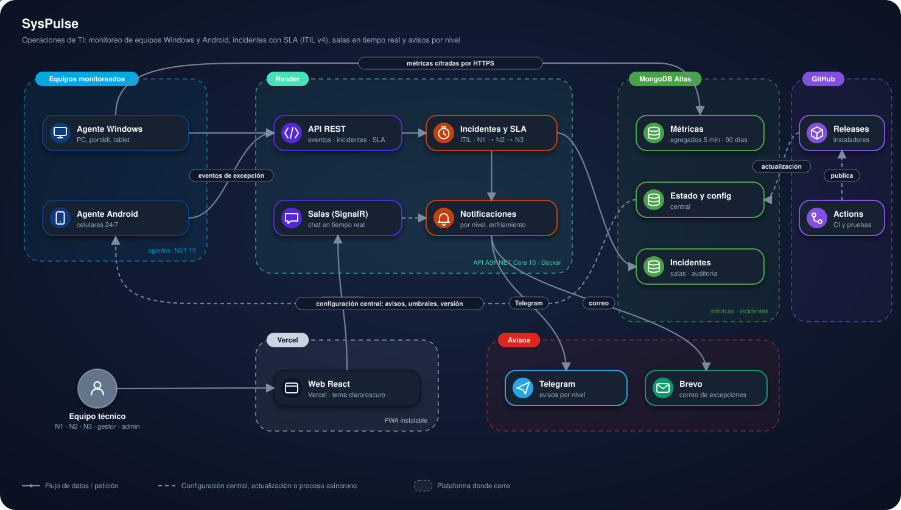

# SysPulse · Monitoreo e incidentes TI

<p>
  <a href="https://syspulse.vercel.app"></a>
  <a href="https://frontend-nine-topaz-99.vercel.app"></a>
  <a href="https://d4i3vsgw7xwmh.cloudfront.net"></a>
</p>


> 📘 **[Manual de usuario](docs/MANUAL.md)**: cómo usar cada pantalla, paso a paso y con imágenes.

## Contenido

1. [Presentación](#1-presentación)
2. [Funcionalidades](#2-funcionalidades)
3. [Arquitectura](#3-arquitectura)
4. [Estructura del proyecto](#4-estructura-del-proyecto)
5. [Instalación para pruebas](#5-instalación-para-pruebas)
6. [Autor y licencia](#6-autor-y-licencia)

---

## 1. Presentación

Plataforma de operaciones de TI en **C# / .NET 10** y **React**. Monitorea equipos Windows y
celulares Android, convierte las alertas en incidentes con SLA y escalamiento **N1 → N2 → N3**,
avisa a cada nivel por Telegram y correo, y coordina al equipo en salas de chat en tiempo real,
siguiendo las prácticas de **ITIL v4** que aplican a un equipo de operaciones.

- **Qué hace:** un agente en cada equipo mide CPU, memoria, disco, red, batería y temperatura cada
  minuto. Si un valor supera su umbral durante varios minutos seguidos, abre un incidente con
  prioridad y fecha límite, y avisa al nivel correspondiente.
- **Qué muestra:** la salud en vivo de cada equipo, los incidentes con su SLA, la conversación del
  equipo por incidente y los indicadores ITIL (cumplimiento de SLA, MTTA, MTTR, escalamientos,
  candidatos a problema y disponibilidad).
- **Cómo probarlo:** entra a la [demo](https://syspulse.vercel.app), crea tu cuenta eligiendo tu
  nivel (N1, N2 o N3) y explora los equipos e incidentes.

## 2. Funcionalidades

- **Monitoreo:** agentes para Windows y Android que reportan cada minuto y guardan los datos si se
  pierde la conexión.
- **Alertas sin ruido:** una alerta solo se abre, escala o cierra si el valor se mantiene varios
  minutos.
- **Incidentes ITIL:** ciclo de vida completo, prioridad por impacto × urgencia, SLA de respuesta y
  resolución con pausa en espera, y escalamiento funcional y jerárquico.
- **Avisos por nivel:** Telegram y correo, sin repetir avisos.
- **Salas:** canal general y una sala por incidente en tiempo real, con presencia y registro de
  cada cambio.
- **Analítica ITIL:** SLA, MTTA, MTTR, escalamiento, resolución en primer nivel, reaperturas,
  candidatos a problema, disponibilidad y capacidad.
- **Cuentas:** registro con verificación de correo y Telegram y verificación en dos pasos
  obligatoria, con recuperación de contraseña y del autenticador.
- **Interfaz:** se instala como aplicación, con tema claro y oscuro; adaptable a celular, tablet y
  computador.

## 3. Arquitectura

<p align="center">
  
</p>

| Capa | Tecnología |
|---|---|
| API | ASP.NET Core 10 y SignalR, en un contenedor |
| Web | React 19, TypeScript y Vite; se instala como aplicación |
| Agente Windows | Servicio .NET 10 |
| Agente Android | .NET MAUI (Android 10+) |
| Datos | Base de datos documental |
| Gráficas | ECharts |
| Pruebas | xUnit en cada cambio; pruebas E2E diarias con Playwright |

## 4. Estructura del proyecto

```
src/
├── SysPulse.Domain/          Reglas: SLA, prioridad, ciclo del incidente y permisos por rol
├── SysPulse.Contracts/       Contratos entre agentes y API
├── SysPulse.Infrastructure/  Datos, cuentas y avisos
├── SysPulse.Api/             API, salas en tiempo real, incidentes y analítica
├── SysPulse.Agent.Core/      Núcleo común de los agentes
├── SysPulse.Agent/           Agente Windows
└── SysPulse.Agent.Android/   Agente Android
tests/                        Pruebas xUnit
web/                          Aplicación web
docs/                         Manual de usuario y diagramas
```

## 5. Instalación para pruebas

1. Requisitos: [.NET 10 SDK](https://dotnet.microsoft.com/download), Node.js 24 y una base de datos
   propia.
2. Copia `.env.example` como `.env` y complétalo con tus propios valores, siguiendo sus comentarios
   (ese archivo no se sube al repositorio).
3. Arranca la API y la web:

   ```bash
   dotnet run --project src/SysPulse.Api
   cd web && npm install && npm run dev
   ```

4. Pruebas: `dotnet test SysPulse.slnx`.

Antes de publicar cambios, revisa [SECURITY.md](SECURITY.md).

## 6. Autor y licencia

**Luis F. A.** · [GitHub](https://github.com/lariasca1994) · [LinkedIn](https://linkedin.com/in/lfac1)

Contacto: Telegram [@lfac6](https://t.me/lfac6) · WhatsApp [@carraian160](https://wa.me/carraian160) ·
[ariascluisf@hotmail.com](mailto:ariascluisf@hotmail.com)

Licencia: MIT.
