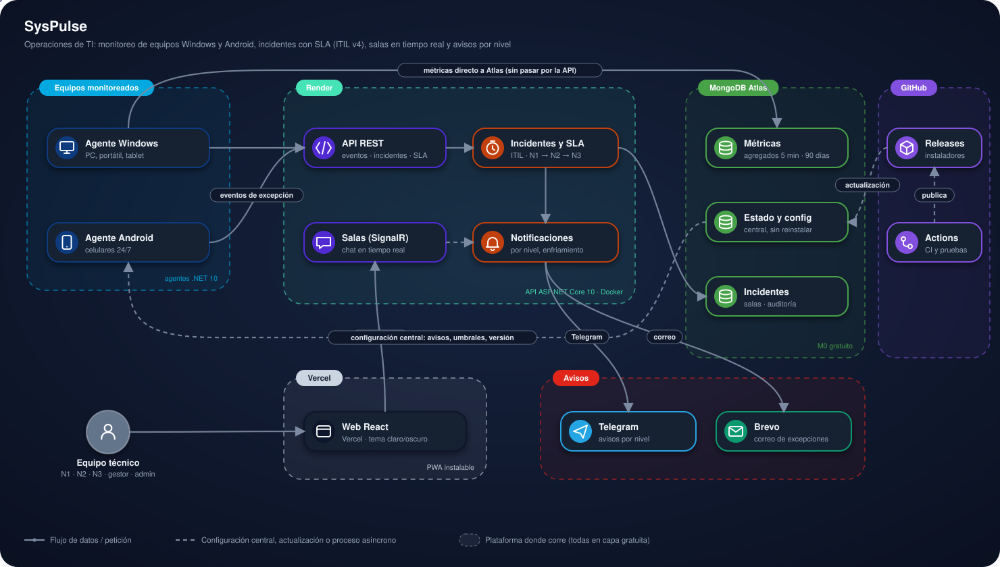

# SysPulse

<p>
  <a href="https://syspulse.vercel.app"></a>
  <a href="https://frontend-nine-topaz-99.vercel.app"></a>
  <a href="https://d4i3vsgw7xwmh.cloudfront.net"></a>
</p>


## Contenido

1. [Presentación](#1-presentación)
2. [Estructura del proyecto](#2-estructura-del-proyecto)
3. [Arquitectura](#3-arquitectura)
4. [Plataformas y su función](#4-plataformas-y-su-función)
5. [Cómo usar la plataforma](#5-cómo-usar-la-plataforma)
6. [Instalación para pruebas](#6-instalación-para-pruebas)
7. [Autor y licencia](#7-autor-y-licencia)

---

## 1. Presentación

Plataforma de operaciones de TI en **C# / .NET 10** y **React**. Monitorea equipos Windows
(computadores, portátiles, tablets) y celulares Android, convierte las alertas en incidentes con
SLA y escalamiento **N1 → N2 → N3**, avisa a cada nivel por Telegram y correo, y coordina al equipo
en salas de chat en tiempo real. Sigue las prácticas de **ITIL v4** que aplican a un equipo de
operaciones. Todo corre en capas gratuitas.

### En pocas palabras

- **Qué hace:** un agente instalado en cada equipo mide CPU, memoria, disco, red, batería y
  temperatura cada minuto. Si un valor supera su umbral **durante 8 minutos seguidos**, abre un
  incidente, le asigna prioridad y fecha límite, y avisa al nivel correspondiente.
- **Qué muestra:** la salud en vivo de cada equipo, los incidentes con su SLA, la conversación del
  equipo por incidente y los indicadores ITIL (cumplimiento de SLA, MTTA, MTTR, escalamientos,
  candidatos a problema, disponibilidad).
- **Cómo probarlo:** entra a la [demo](https://syspulse.vercel.app), crea tu cuenta eligiendo tu
  nivel (N1, N2 o N3), confirma tu correo y tu Telegram, y activa tu app autenticadora. Para
  correrlo en tu equipo, ve a [Instalación para pruebas](#6-instalación-para-pruebas).

### Demo en vivo

**Aplicación:** [abrir la demo en vivo](https://syspulse.vercel.app)

> La API usa el plan gratuito de Render: si llevaba un rato sin uso, la primera visita tarda hasta
> un minuto en despertar (la web lo indica con un aviso).

### Funcionalidades

- **Monitoreo:** agentes para Windows (servicio) y Android (servicio en primer plano 24/7) que envían
  métricas cada minuto, con chequeos de red (TCP, ping, DNS) y almacenamiento local si no hay internet.
- **Alertas sin ruido:** histéresis y persistencia mínima de 8 minutos para abrir, escalar o cerrar
  una alerta, configurable desde la web.
- **Incidentes ITIL:** ciclo de vida completo (nuevo, asignado, en progreso, en espera, resuelto,
  cerrado, reabierto), prioridad por impacto × urgencia, SLA de respuesta y resolución con pausa en
  espera, escalamiento funcional N1 → N2 → N3 y jerárquico al gestor (75 % y 100 % del SLA).
- **Avisos por nivel:** Telegram (excepciones y advertencias) y correo (excepciones y P1), con
  enfriamiento para no repetir avisos.
- **Salas:** canal general `#operaciones` y una sala por incidente en tiempo real, con presencia,
  “escribiendo…” y registro automático de cada cambio del incidente.
- **Analítica ITIL:** SLA, MTTA, MTTR, escalamiento, resolución en primer nivel, reaperturas,
  candidatos a problema, disponibilidad y capacidad de los equipos, y cambios del período.
- **Cuentas seguras:** registro propio, verificación de correo y de Telegram, contraseña robusta,
  MFA obligatorio (TOTP con códigos de recuperación), cambio y restablecimiento de contraseña.
- **Equipos sin fricción:** alta con un código de un solo uso, nombres genéricos (nunca el modelo ni
  el nombre del equipo) y actualización automática de los agentes con verificación de huella.
- **PWA instalable** con tema claro y oscuro.

### Stack

| Capa | Tecnología |
|---|---|
| API | ASP.NET Core 10 (Minimal APIs) + SignalR, en Docker |
| Web | React 19 + TypeScript + Vite, CSS Modules, PWA |
| Agente Windows | .NET 10 Worker Service (servicio de Windows), SQLite local |
| Agente Android | .NET MAUI (Android 10+), servicio en primer plano |
| Base de datos | MongoDB Atlas (M0) |
| Avisos | Telegram Bot API y API transaccional de Brevo |
| Gráficas | ECharts |
| Pruebas | xUnit (dominio, núcleo del agente e infraestructura) y Playwright |

---

## 2. Estructura del proyecto

```
SysPulse/
├── SysPulse.slnx
├── src/
│   ├── SysPulse.Domain/           # Reglas puras: SLA, prioridad, ciclo del incidente, permisos por rol
│   ├── SysPulse.Contracts/        # Contratos entre agentes y API (eventos, alta de equipos)
│   ├── SysPulse.Infrastructure/   # MongoDB, cuentas y MFA, cifrado, Telegram, correo, notificaciones
│   ├── SysPulse.Api/              # API REST, hub de salas (SignalR), incidentes, analítica, administración
│   ├── SysPulse.Agent.Core/       # Núcleo común de los agentes: alertas, buffer SQLite, envío, actualización
│   ├── SysPulse.Agent/            # Agente Windows (servicio)
│   └── SysPulse.Agent.Android/    # Agente Android (.NET MAUI)
├── tools/
│   ├── SysPulse.AgentInstaller/   # Instalador público del agente Windows (sin secretos)
│   ├── SysPulse.Herramientas/     # Herramientas privadas de administración (no se publican)
│   └── escanear-secretos.ps1      # Revisión obligatoria de los paquetes antes de publicarlos
├── tests/                         # Pruebas xUnit
├── web/                           # Frontend React + PWA
├── deploy/Dockerfile.api          # Imagen de la API para Render
└── docs/                          # Diagrama de arquitectura e insignias
```

---

## 3. Arquitectura

<p align="center">
  
</p>

- Los **agentes** escriben las métricas **directo en MongoDB Atlas** (agregados de 5 minutos y el
  estado actual de cada minuto). La API solo recibe **eventos**: la apertura, el escalamiento o el
  cierre de una alerta.
- La **API** convierte las excepciones en incidentes, calcula el SLA al consultar (sin procesos que
  revisen la base en segundo plano), envía los avisos por nivel y mantiene las salas en tiempo real.
- La **web** se conecta a la API por HTTPS y a las salas por WebSocket.
- La **configuración central** (umbrales, persistencia, cuentas de aviso, versión publicada) vive en
  Atlas: los agentes la releen cada 5 minutos y la aplican sin reinstalar.

### Uso de recursos bajo demanda

- La API en Render se duerme sin uso: los agentes **no** la despiertan para enviar métricas, solo
  cuando hay una excepción real.
- El agente de Windows vigila el SLA de los incidentes abiertos leyendo Atlas y solo despierta a la
  API cuando un incidente cruza el 75 % o el 100 % de su plazo.
- Si la API no responde a tiempo, el agente guarda el evento y lo reintenta hasta que la API lo
  recibe: solo la API envía avisos, así que los equipos nunca guardan el token del bot de Telegram ni
  las cuentas de las personas.

### Avisos por Telegram y correo

| Severidad | Telegram | Correo |
|---|:-:|:-:|
| Excepción (y todo P1) | ✓ | ✓ |
| Advertencia | ✓ | |

Los destinatarios dependen del **nivel** del incidente (N1, N2 o N3), del **gestor** en los
escalamientos por SLA y del **admin** en los P1. Las cuentas de Telegram fijas reciben todo. Un aviso
igual no se repite durante 30 minutos.

### ITIL v4 en SysPulse

| Práctica | Cómo se aplica |
|---|---|
| Monitoreo y eventos | Umbrales con histéresis y persistencia; deduplicación por equipo y métrica |
| Gestión de incidentes | Ciclo de vida, prioridad impacto × urgencia, escalamiento N1 → N2 → N3 |
| Niveles de servicio | SLA de respuesta y resolución, avisos al 75 % y 100 %, MTTA y MTTR |
| Mesa de servicio | Salas por incidente con el registro de cada cambio |
| Gestión de problemas | Candidatos a problema: la misma alerta 3 veces o más en 7 días |
| Habilitación de cambios | Cada versión de agente publicada queda registrada como cambio estándar |
| Gestión de activos | Alta de equipos con código, nombres genéricos y retiro sin borrar historial |

### Datos que captura

Los agentes envían **solo métricas técnicas de salud**, sin datos sensibles ni información personal de
los equipos agregados:

| Se captura | No se captura nunca |
|---|---|
| Identificador anónimo del equipo (`win-` / `and-` + huella de 10 caracteres) | Nombre del equipo, usuario de Windows o cuenta del celular |
| Tipo de equipo (Windows o Android) y versión del agente | Marca, modelo, número de serie o IMEI |
| Uso de CPU, memoria, paginación y disco (promedio, mínimo, máximo y percentil 95 por ventana) | Archivos, documentos, fotos, contactos o mensajes |
| Red: tráfico y consumo por tipo de conexión (Wi-Fi, cable UTP y datos móviles), errores, latencia y pérdida hacia DNS públicos, intensidad de señal y cantidad de puertos en escucha | Direcciones IP, ubicación, nombre de la red Wi-Fi o aplicaciones instaladas |
| Almacenamiento libre y, en celulares, batería (nivel, carga, salud, temperatura y voltaje) | Contenido del almacenamiento o datos de las aplicaciones |
| Eventos de alerta cuando una métrica supera un umbral | Historial de navegación o pulsaciones de teclado |

En la plataforma cada equipo aparece con un nombre genérico (“Equipo portátil 2”, “Celular 1”) que
asigna el sistema.

### Seguridad y estado

- **Al día en seguridad:** el runtime, el sistema y las dependencias se mantienen con los últimos
  parches y se revisan periódicamente.
- **Cuentas:** contraseña con PBKDF2, MFA obligatorio, bloqueo por intentos, sesiones que se cierran
  al cambiar contraseña, rol o MFA, y auditoría de solo inserción.
- **Roles:** N1, N2 y N3 los elige cada persona al registrarse; el rol **gestor** se solicita y solo
  lo aprueba el **admin**. Nadie borra datos: el admin solo desactiva o retira.
- **Privacidad:** la plataforma nunca muestra el nombre, la marca ni el modelo de los equipos; solo
  nombres genéricos (“Equipo portátil 2”, “Celular 1”).
- **Instaladores públicos sin secretos:** el equipo recibe su configuración al canjear un código de un
  solo uso (24 h; solo se guarda su huella) y la guarda cifrada (DPAPI en Windows, Android Keystore).
  Antes de cada publicación, `tools/escanear-secretos.ps1` revisa que los paquetes no contengan
  secretos, datos personales ni rutas del equipo de compilación. La app Android se publica sin modo
  de depuración.
- **Actualizaciones obligatorias:** solo desde GitHub Releases por HTTPS; la huella SHA-256 esperada
  viaja por la configuración central y un archivo alterado se descarta. En Windows las instala el servicio
  "SysPulse Actualizador" cada hora, sin tareas programadas. En Android la app se instala a sí misma con el
  instalador del sistema: la primera vez pide confirmación (notificación fija hasta instalar) y desde ahí
  se actualiza sola.
- Lee [SECURITY.md](SECURITY.md) antes de publicar.
- Pruebas: 156 pruebas xUnit del dominio, el núcleo del agente y la infraestructura, y pruebas de punta
  a punta con Playwright sobre una base de pruebas aparte.

---

## 4. Plataformas y su función

| Plataforma | Función en el proyecto |
|---|---|
|  | Corre la API ASP.NET Core 10 en Docker (REST y salas por WebSocket). Se duerme sin uso. |
|  | Publica la web React como PWA instalable. |
|  | Guarda métricas (90 días), estado, configuración central, cuentas, incidentes, salas y auditoría. |
|  | Verifica la cuenta de cada persona y envía los avisos por nivel. |
|  | Envía los correos: verificación, restablecimiento de contraseña y excepciones. |
|  | Publica los instaladores de los agentes (repositorio público solo con binarios). |
|  | Compila, corre las pruebas y valida la imagen Docker en cada cambio. |

---

## 5. Cómo usar la plataforma

### 5.1 Crear una cuenta

1. En el inicio de sesión, pulsa **Regístrate**.
2. Completa el formulario:

   | Campo | Dato |
   |---|---|
   | Nombre completo | Tu nombre |
   | Correo | Con el que vas a iniciar sesión |
   | Tu nivel | N1, N2 o N3 |
   | Telegram | Tu @usuario o tu número con el indicativo del país |
   | Contraseña | Mínimo 12 caracteres (mejor una frase larga) |

3. Confirma tu correo con el enlace que te llega.
4. Abre el bot desde el botón, pulsa **Iniciar** y escribe el código que te envía.

### 5.2 Iniciar sesión

1. Escribe tu correo y tu contraseña y pulsa **Continuar**.
2. La primera vez, escanea el QR con tu app autenticadora (Google o Microsoft Authenticator, Authy)
   y **guarda los 10 códigos de recuperación**.
3. Las siguientes veces, escribe el código de 6 dígitos de la app.
4. Si olvidaste la contraseña, usa **¿Olvidaste tu contraseña?**: llega un enlace al correo y además se
   pide el código de la app autenticadora.

### 5.3 Mi turno

Muestra lo que tienes asignado y lo que puedes tomar en tu nivel, ordenado por lo que vence primero.
El gestor ve los incidentes con SLA en riesgo, vencidos o P1.

### 5.4 Salud de hosts

Cada equipo aparece con su estado (en línea, retrasado, sin reporte), su salud (saludable,
advertencia, excepción) y sus principales indicadores. Al abrir un equipo se ven sus alertas, las
gráficas de 6 h, 24 h o 7 días con las líneas de umbral y todas sus lecturas.

### 5.5 Incidentes

1. Los crea el monitoreo con cada excepción, o cualquier persona con **Registrar incidente**
   (la prioridad sale de impacto × urgencia).
2. En el detalle, según tu rol: **Tomar**, **Iniciar trabajo**, **En espera** (pausa el SLA),
   **Escalar**, **Asignar**, **Prioridad**, **Resolver** (con código de cierre) y **Cerrar**.
3. El SLA por prioridad:

   | Prioridad | Primera respuesta | Resolución |
   |---|---|---|
   | P1 | 15 min | 4 h |
   | P2 | 30 min | 8 h |
   | P3 | 2 h | 24 h |
   | P4 | 8 h | 72 h |
   | P5 | 24 h | 5 días |

### 5.6 Salas

`#operaciones` reúne los avisos generales (incidentes nuevos, escalamientos, resoluciones). Cada
incidente tiene su sala; el botón **Sala** del incidente lleva a ella. Puedes retirar un mensaje
propio durante 15 minutos. Al cerrarse el incidente, su sala queda de solo lectura como registro.

### 5.7 Analítica

Elige el período (7, 30 o 90 días) para ver los indicadores de niveles de servicio, gestión de
incidentes, candidatos a problema, disponibilidad de los equipos y cambios registrados.

### 5.8 Mi cuenta

Desde tu nombre, arriba a la derecha: cambia tu contraseña, configura la app autenticadora en otro
teléfono y, si eres N1, N2 o N3, solicita el rol de gestor.

### 5.9 Agregar equipos

1. Un técnico **N2 o N3** pulsa **Agregar equipo** en **Salud de hosts** (también está en
   **Administración → Equipos**) y obtiene un código (sirve una vez, vence en 24 horas).
2. **Windows (computador, portátil o tablet):** descarga
   [`SysPulse.Agent-win-x64.zip`](https://github.com/lariasca1994/syspulse-agentes/releases/latest/download/SysPulse.Agent-win-x64.zip),
   descomprímelo y, en PowerShell como administrador dentro de esa carpeta:
   ```powershell
   .\SysPulse.AgentInstaller.exe install --codigo XXXX-XXXX
   ```
   Con poco espacio en C:, agrega `--destino D:\SysPulse\Agent --datos D:\SysPulse\Datos`.
3. **Android:** instala
   [`SysPulse-agente-android.apk`](https://github.com/lariasca1994/syspulse-agentes/releases/latest/download/SysPulse-agente-android.apk),
   abre **SysPulse Agent**, escribe el código y pulsa **Vincular**.
4. En menos de un minuto el equipo aparece en **Salud de hosts**. Desde ahí se actualiza solo.

### 5.10 Roles y administración

| Rol | Qué hace |
|---|---|
| N1, N2, N3 | Toman, trabajan, escalan y resuelven incidentes de su nivel; N2 y N3 además agregan equipos al monitoreo |
| Gestor | Decide sobre riesgo y prioridad (incluido P1), reasigna y recibe los escalamientos por SLA |
| Admin | Administra equipos, cuentas, solicitudes de gestor y alertas; puede hacer todo lo anterior |

En **Administración** el admin agrega, renombra o retira equipos; desactiva o reactiva cuentas;
aprueba, rechaza o revoca el rol gestor; y ajusta la persistencia y los umbrales de alerta.

### Si el servicio no responde

Si la API o la base de datos (MongoDB Atlas) no responden, la aplicación muestra una **pantalla de mantenimiento** con los colores del proyecto, en lugar de un error genérico o de una página que no carga.

- **Servidor:** La API arranca aunque MongoDB no responda (`InicioApi` reintenta índices y admin semilla cada 30 s). Los errores de conexión a MongoDB responden **503** con `Retry-After` y CORS (`BaseNoDisponible`).
- **Pantalla:** `web/src/api/cliente.ts` activa el mantenimiento sin conexión o con 502/503/504, y `componentes/Mantenimiento.tsx` muestra la pantalla con los tokens del sistema de diseño.
- **Recuperación:** Consulta `/health` cada 15 s y recarga la página sola cuando el servicio vuelve. No reintenta acciones del usuario, para no duplicarlas.

---

## 6. Instalación para pruebas

### Requisitos

- [.NET 10 SDK](https://dotnet.microsoft.com/download) (y el workload `maui-android` para el agente
  Android).
- Node.js 24.22.1 o superior.
- Una base de MongoDB Atlas (M0 gratuito).

### Configuración

Copia `.env.example` a `.env` en la raíz y completa los valores (ese archivo está en `.gitignore` y
nunca se sube). Lo mínimo para la API: `MONGO_URI`, `JWT_SECRET`, `MFA_ENCRYPTION_KEY`,
`AGENT_API_KEY`, `ADMIN_EMAIL` y `ADMIN_TEMP_PASSWORD`. Sin `CORREO_ENVIAR=true` los correos solo se
registran en el log, y en desarrollo los enlaces aparecen en pantalla.

### Ejecución

```bash
# API (http://localhost:5095)
ASPNETCORE_ENVIRONMENT=Development dotnet run --project src/SysPulse.Api

# Web (http://localhost:5173)
cd web
npm install
npm run dev

# Pruebas
dotnet test SysPulse.slnx
```

El primer inicio de sesión con `ADMIN_EMAIL` y `ADMIN_TEMP_PASSWORD` pide crear una contraseña propia
y configurar el MFA.

### Despliegue

1. **API en Render:** servicio web con `deploy/Dockerfile.api`; las variables de entorno viven en
   Render (nunca en el repositorio). Cada push a `main` la despliega cuando pasa el CI, que antes
   copia desde los secretos de GitHub la credencial exclusiva de los agentes (`MONGO_URI_AGENTES*`).
2. **Web en Vercel:** proyecto con raíz en `web/`; la URL de la API está en `web/.env.production`.
3. **Telegram:** el webhook apunta a `https://<api>/api/telegram/webhook` con el secreto de
   `TELEGRAM_WEBHOOK_SECRET`.
4. **Versiones de los agentes:** se publican en GitHub Releases, se revisan con
   `tools/escanear-secretos.ps1` y se anuncian con
   `dotnet run --project tools/SysPulse.Herramientas -- publicar-version …`; los equipos se actualizan
   solos.

---

## 7. Autor y licencia

> 📘 **[Manual de usuario](docs/MANUAL.md)**: cómo usar la plataforma campo por campo, qué datos se ingresan y qué garantiza en seguridad.

**Luis Felipe Arias Carriazo**
[GitHub](https://github.com/lariasca1994) · [LinkedIn](https://linkedin.com/in/lfac1)

Licencia: MIT.
