# 📘 Manual de usuario · Monitoreo e incidentes TI (SysPulse)

## 1. Portada

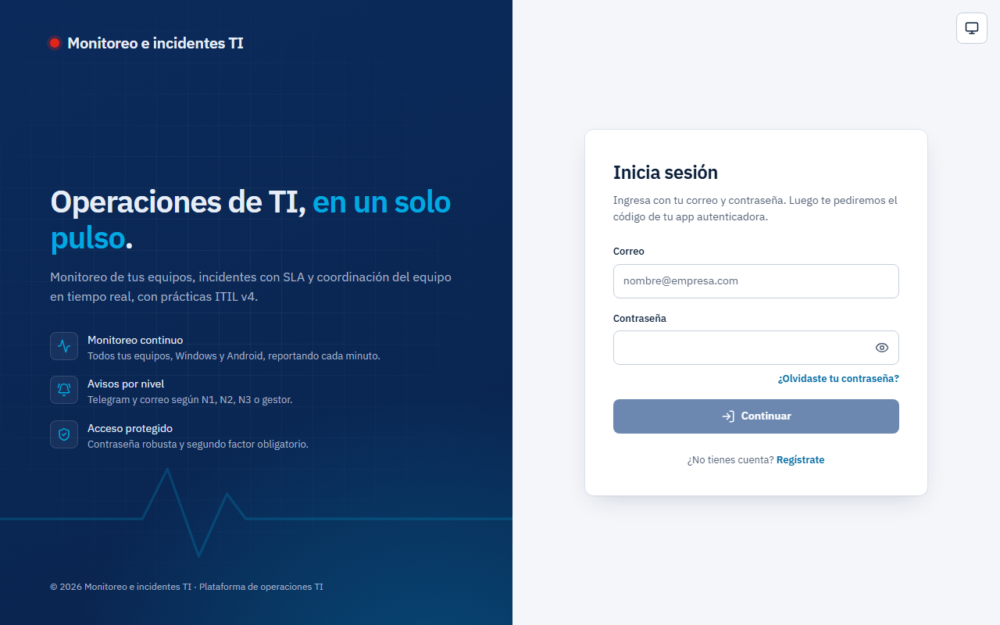

| | |
|---|---|
| **Producto** | Monitoreo e incidentes TI (SysPulse) |
| **Documento** | Manual de usuario |
| **Versión** | 2.0 · noviembre de 2026 |
| **Dirigido a** | Técnicos de soporte (N1, N2 y N3) y gestores del servicio |
| **Dirección** | [Monitoreo e incidentes TI](https://syspulse.vercel.app) |
| **Autor** | Luis F. A. |

## Contenido

1. [Portada](#1-portada)
2. [Introducción](#2-introducción)
3. [Objetivo](#3-objetivo)
4. [Alcance](#4-alcance)
5. [Acceso al sistema](#5-acceso-al-sistema)
6. [Pantalla principal](#6-pantalla-principal)
7. [Navegación](#7-navegación)
8. [Funcionalidades](#8-funcionalidades)
9. [Gestión de perfil](#9-gestión-de-perfil)
10. [Mensajes frecuentes](#10-mensajes-frecuentes)
11. [Preguntas frecuentes](#11-preguntas-frecuentes)
12. [Glosario](#12-glosario)

---

## 2. Introducción

**Monitoreo e incidentes TI** vigila la salud de los computadores, portátiles, tablets y celulares
de la organización. Un agente instalado en cada equipo mide CPU, memoria, disco, red, batería y
temperatura cada minuto; si un valor supera su umbral durante varios minutos seguidos, se abre un
**incidente** con prioridad y tiempo máximo de atención (**SLA**), se avisa al nivel de soporte que
corresponde y el equipo lo coordina en una **sala** en tiempo real.

Este manual explica cada pantalla, paso a paso y con imágenes.

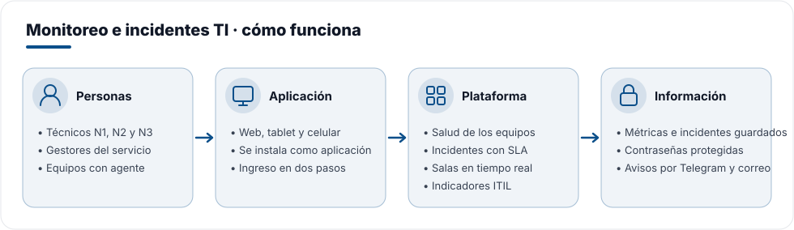

## 3. Objetivo

Que cualquier persona del equipo de soporte pueda, sin conocimientos técnicos:

- Crear su cuenta e ingresar de forma segura.
- Ver en un vistazo qué equipos necesitan atención.
- Registrar, tomar, escalar y resolver incidentes dentro de su SLA.
- Coordinarse con el equipo y revisar los indicadores del servicio.

## 4. Alcance

**Incluye:** registro con verificación de correo y Telegram, ingreso en dos pasos, salud de los
equipos, incidentes con SLA y escalamiento N1 → N2 → N3, salas en tiempo real, analítica ITIL y uso
en celular, tablet y computador.

**No incluye:** control remoto de los equipos ni acceso a sus archivos: el agente solo envía
métricas técnicas.

**Qué necesitas:** un navegador actualizado, conexión a internet, un correo propio, una cuenta de
Telegram y una app autenticadora en el celular (o acceso a tu correo para recibir códigos).

## 5. Acceso al sistema

### 5.1 Crear una cuenta

En el inicio de sesión pulsa **Regístrate**.

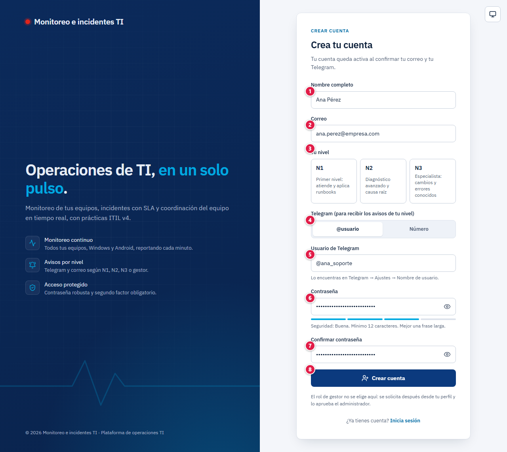

| # | Campo | Qué escribir |
|:-:|---|---|
| 1 | Nombre completo | Tu nombre |
| 2 | Correo | Un correo al que tengas acceso: te llega un enlace para confirmarlo |
| 3 | Tu nivel | **N1** (primer nivel), **N2** (diagnóstico avanzado) o **N3** (especialista) |
| 4 | Telegram | Elige si escribes tu **@usuario** o tu **número** |
| 5 | Usuario de Telegram | Tu usuario; ahí recibes los avisos de tu nivel |
| 6 | Contraseña | Mínimo 12 caracteres; mejor una frase larga |
| 7 | Confirmar contraseña | La misma contraseña |
| 8 | Crear cuenta | Crea la cuenta; queda activa al confirmar tu correo y tu Telegram |

El rol de **gestor** no se elige aquí: se solicita después desde **Mi cuenta**.

### 5.2 Iniciar sesión

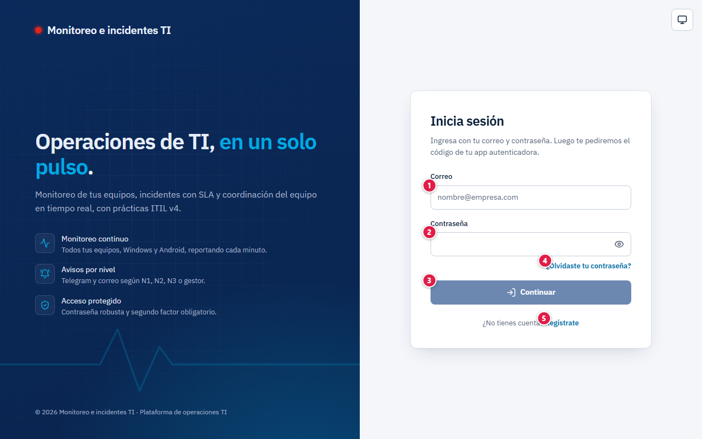

| # | Elemento | Qué hace |
|:-:|---|---|
| 1 | Correo | El correo de tu cuenta |
| 2 | Contraseña | Tu contraseña |
| 3 | Continuar | Comprueba tus datos y pide el código de tu segundo factor |
| 4 | ¿Olvidaste tu contraseña? | Abre la recuperación de contraseña (5.4) |
| 5 | Regístrate | Crea una cuenta nueva (5.1) |

### 5.3 Verificación en dos pasos

La primera vez eliges cómo recibir el código: con una **app autenticadora** (escaneas un QR;
recomendado) o con un **código por correo**. Al activarla recibes **10 códigos de recuperación**:
guárdalos, sirven si no tienes el teléfono.

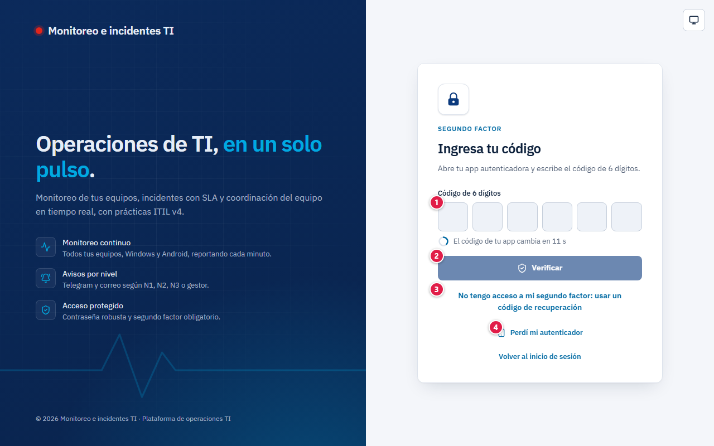

| # | Elemento | Qué hace |
|:-:|---|---|
| 1 | Código de 6 dígitos | El código de tu app (o del correo); el círculo indica cuánto falta para que cambie |
| 2 | Verificar | Confirma el código y abre la plataforma |
| 3 | Usar un código de recuperación | Si no tienes tu segundo factor, entra con uno de tus códigos guardados |
| 4 | Perdí mi autenticador | Configura un autenticador nuevo con un código enviado a tu correo |

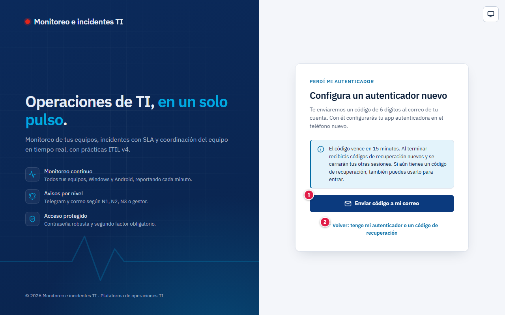

En **Perdí mi autenticador** pulsa **Enviar código a mi correo** (1), escribe el código que llega y
configura la app del teléfono nuevo. Recibes códigos de recuperación nuevos y el autenticador
anterior deja de funcionar. **Volver** (2) regresa al paso del código.

### 5.4 Recuperar la contraseña

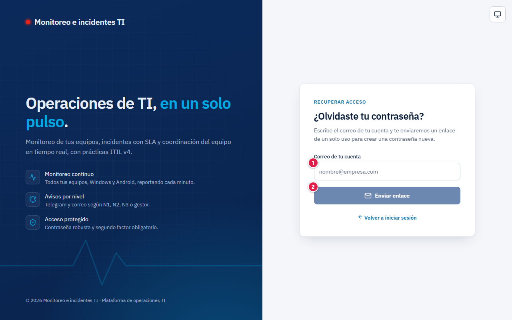

| # | Elemento | Qué hace |
|:-:|---|---|
| 1 | Correo de tu cuenta | El correo con el que te registraste |
| 2 | Enviar enlace | Envía un enlace para crear una contraseña nueva (vence pronto y sirve una sola vez) |

El enlace abre esta pantalla:

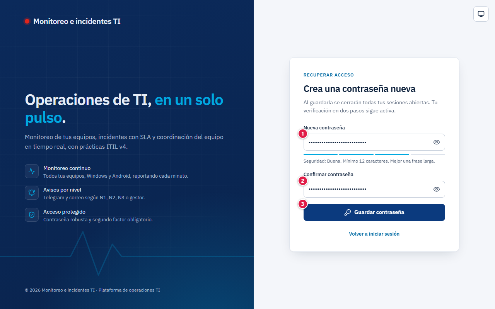

Escribe la contraseña nueva dos veces (1 y 2) y pulsa **Guardar contraseña** (3). Tu verificación en
dos pasos sigue activa.

## 6. Pantalla principal

**Mi turno** reúne lo que tienes asignado y lo que puedes tomar en tu nivel, ordenado por lo que
vence primero.

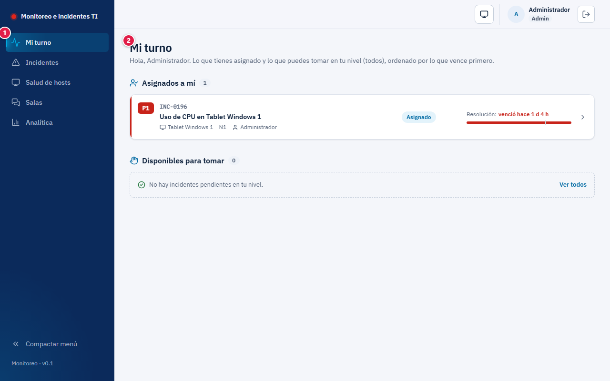

| # | Elemento | Qué hace |
|:-:|---|---|
| 1 | Menú | Lleva a Mi turno, Incidentes, Salud de hosts, Salas y Analítica |
| 2 | Mi turno | Asignados a ti y disponibles para tomar; cada fila muestra prioridad, equipo, nivel, estado y la barra del SLA (roja si ya venció) |

## 7. Navegación

En el computador el menú está a la izquierda; **Compactar menú** lo reduce a íconos. Arriba a la
derecha están el cambio de tema (claro u oscuro), tu cuenta y **Salir**. En la tablet y en el
celular el menú pasa a una barra inferior.

| Tablet en vertical | Celular |
|:-:|:-:|
| 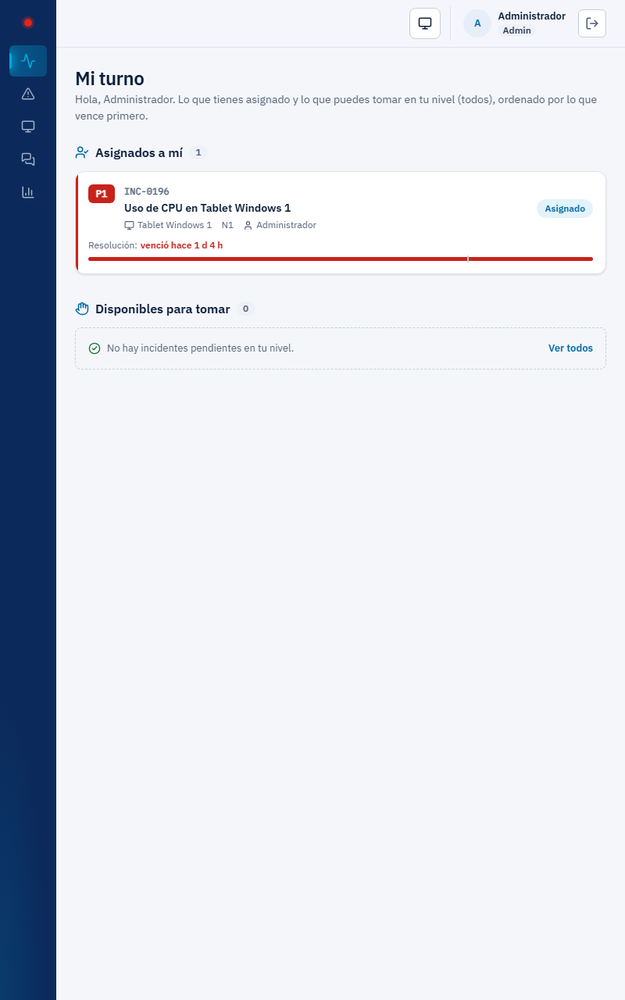 | 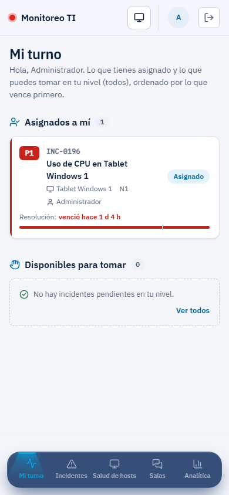 |

## 8. Funcionalidades

### 8.1 Crear: registrar un incidente

En **Incidentes** pulsa **Registrar incidente**.

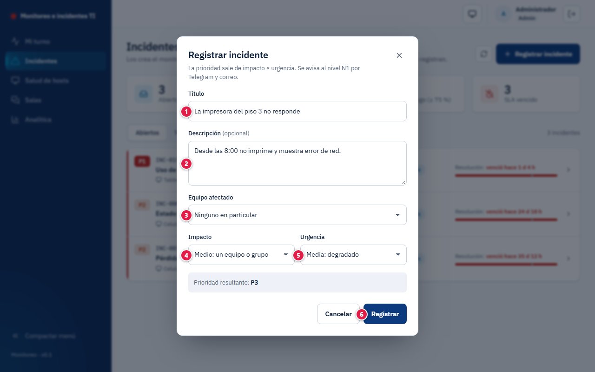

| # | Campo | Qué escribir |
|:-:|---|---|
| 1 | Título | Resumen de la falla (entre 5 y 140 caracteres) |
| 2 | Descripción | Opcional: qué pasa y desde cuándo |
| 3 | Equipo afectado | Uno de los equipos monitoreados, o **Ninguno en particular** |
| 4 | Impacto | **Alto** (muchos afectados), **Medio** (un equipo o grupo) o **Bajo** (una persona) |
| 5 | Urgencia | Qué tan rápido hay que actuar |
| 6 | Registrar | Crea el incidente; la **prioridad resultante** (P1 a P5) se calcula sola y se avisa al nivel N1 |

### 8.2 Consultar: incidentes y salud de los equipos

**Incidentes** resume los abiertos, los que nadie ha tomado y los SLA en riesgo o vencidos.
**Abiertos** y **Todos** cambian la lista.

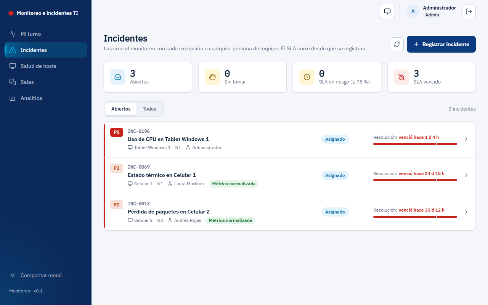

**Salud de hosts** muestra cuántos equipos están en línea, saludables, con alertas o en excepción.
Puedes buscar por nombre o modelo, filtrar los que **requieren atención** o por tipo, y ver
**tarjetas** o **lista**. Cada equipo muestra su estado, sus indicadores con las marcas de umbral y
su consumo de red; se actualiza cada 30 segundos.

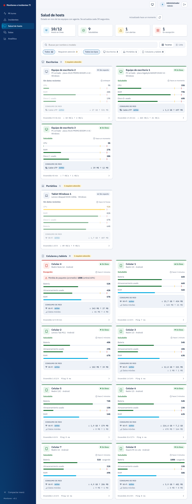

Al abrir un equipo ves sus alertas, las gráficas del historial (6 h, 24 h o 7 días) y todas sus
lecturas:

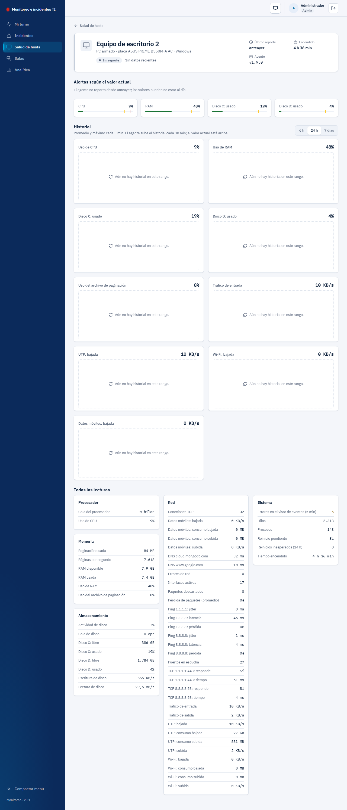

### 8.3 Modificar: atender un incidente

En el detalle del incidente, según tu nivel, aparecen **Sala**, **Tomar** o **Iniciar trabajo**,
**Resolver**, **Escalar**, **Asignar** y **Prioridad**. El **Historial** registra cada cambio, incluidos
los avisos automáticos del SLA, y el cuadro de abajo agrega notas para el equipo. A la derecha, las
barras de **Respuesta** y **Resolución** muestran cuánto del plazo se ha consumido.

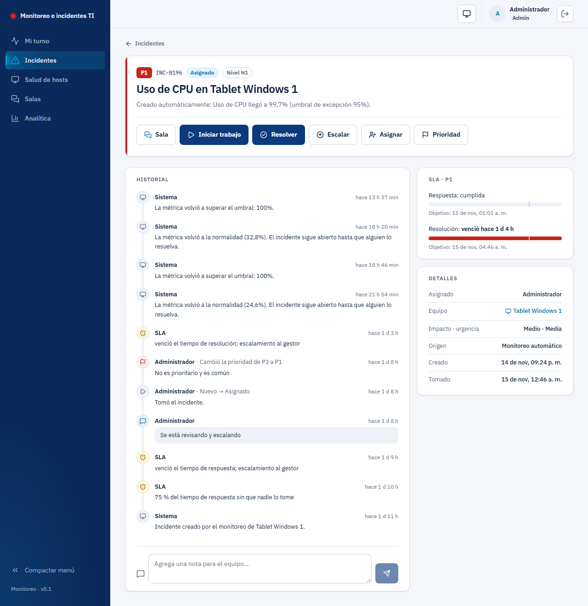

**Salas:** `#operaciones` reúne los avisos generales y cada incidente tiene su propia sala. Escribe
abajo (Enter envía, Shift + Enter hace un salto de línea); a la izquierda ves quién está en línea.

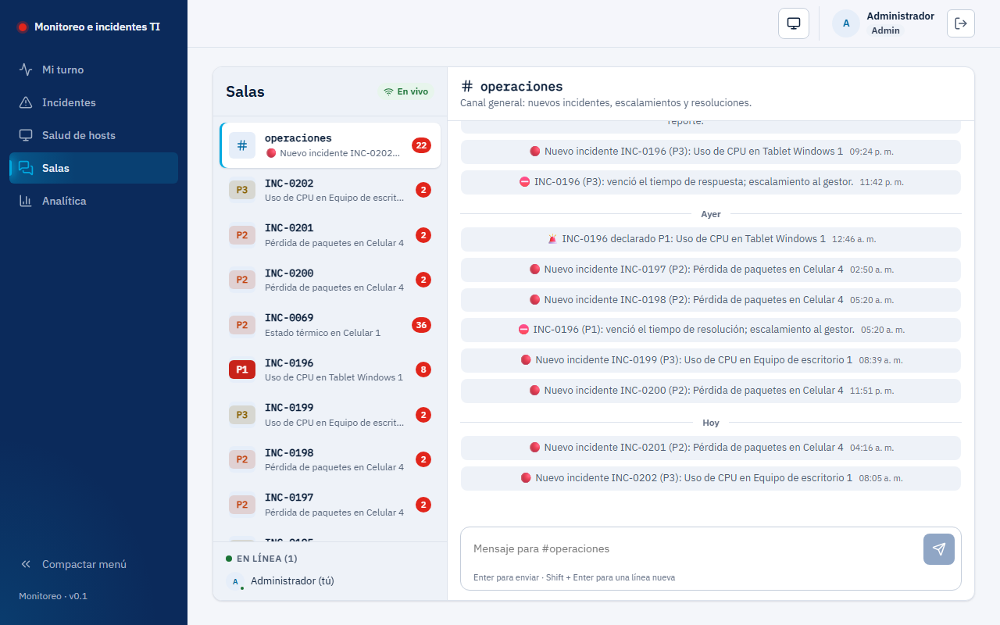

### 8.4 Reportar: analítica ITIL

**Analítica** resume el servicio en el período que elijas (7 o 15 días).

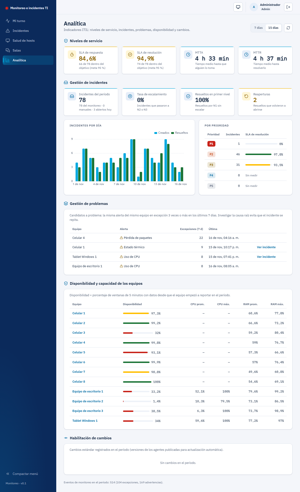

| Bloque | Qué mide |
|---|---|
| Niveles de servicio | Cumplimiento del SLA de respuesta y de resolución, MTTA y MTTR |
| Gestión de incidentes | Incidentes del período, escalamiento, resueltos en primer nivel y reaperturas, por día y por prioridad |
| Gestión de problemas | Candidatos a problema: la misma alerta del mismo equipo 3 veces o más en 7 días |
| Disponibilidad y capacidad | Disponibilidad y uso promedio y máximo de CPU y RAM de cada equipo |
| Habilitación de cambios | Versiones de los agentes publicadas en el período |

## 9. Gestión de perfil

En **Mi cuenta** (tu nombre, arriba a la derecha) ves tu correo, tu Telegram, el estado de la
verificación en dos pasos y tu nivel.

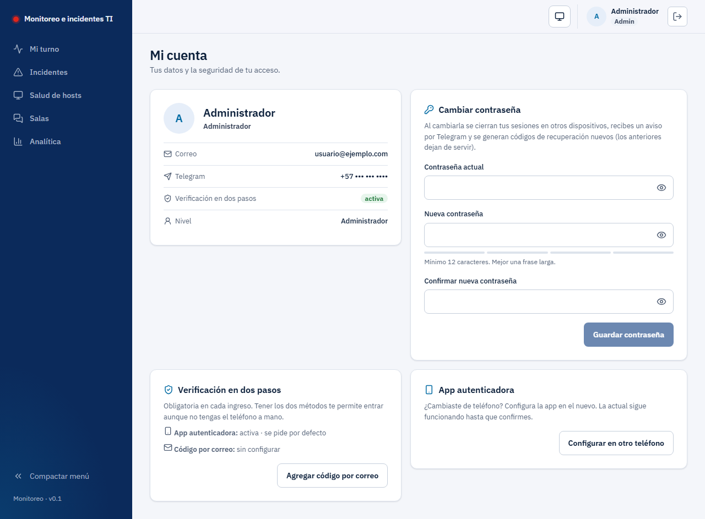

- **Cambiar contraseña:** contraseña actual, nueva (mínimo 12 caracteres) y confirmación. Al
  guardarla se cierran tus otras sesiones y recibes códigos de recuperación nuevos.
- **Verificación en dos pasos:** agrega el método que te falta y elige cuál se pide por defecto.
- **App autenticadora → Configurar en otro teléfono:** la app actual sigue funcionando hasta que
  confirmes la nueva.
- **Solicitar rol gestor:** la solicitud la aprueba el administrador.

## 10. Mensajes frecuentes

| Mensaje | Qué significa | Qué hacer |
|---|---|---|
| Correo o contraseña incorrectos. | Los datos no coinciden | Revísalos o usa **¿Olvidaste tu contraseña?** |
| Confirma tu correo con el enlace que te enviamos. | Falta confirmar el correo | Abre el enlace del correo (revisa también spam) |
| El código no es correcto. Revisa la hora de tu teléfono e inténtalo de nuevo. | La hora del teléfono está desfasada | Activa la hora automática del teléfono |
| Demasiados códigos incorrectos. Espera 15 minutos e intenta de nuevo. | El ingreso se bloqueó por seguridad | Espera 15 minutos |
| El enlace no es válido o ya venció. Solicita uno nuevo. | El enlace de recuperación ya no sirve | Pide uno nuevo |
| El título debe tener entre 5 y 140 caracteres. | El título es muy corto o muy largo | Ajusta el título |
| Elige impacto y urgencia. | Faltan datos para calcular la prioridad | Elige los dos valores |
| El incidente está cerrado: la sala es de solo lectura. | Ya no se pueden enviar mensajes | Consulta el historial |
| Esta página no reporta | La dirección no existe | Usa **Ir a Incidentes** o **Volver al inicio** |
| Sin conexión | Tu equipo no tiene internet | La pantalla reintenta sola |

| Página no encontrada | Sin conexión |
|:-:|:-:|
| 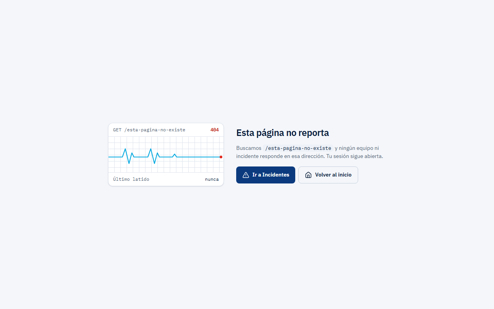 | 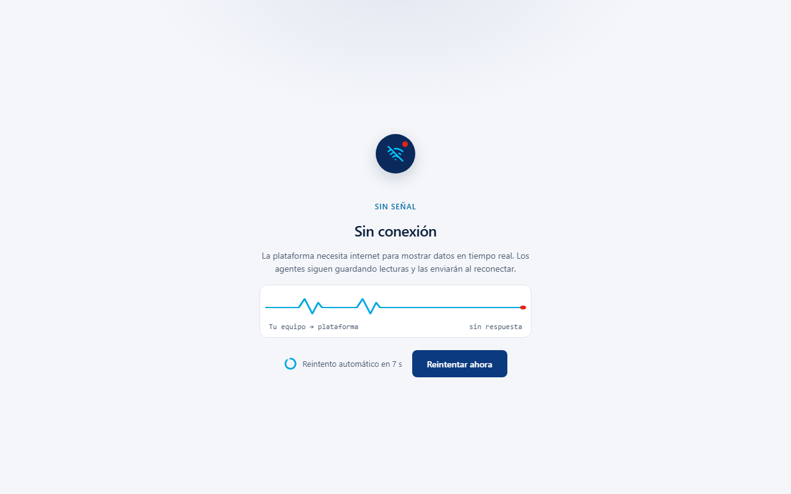 |

## 11. Preguntas frecuentes

**¿El agente puede ver mis archivos o lo que escribo?** No. Solo envía métricas técnicas del equipo
(uso de CPU, memoria, disco, red, batería y temperatura).

**¿Por qué la primera visita tarda un poco?** El servicio se suspende cuando nadie lo usa y tarda
hasta un minuto en reactivarse; la web lo indica con un aviso.

**¿Por qué un incidente subió de nivel?** Se acercó o venció su SLA: el escalamiento es automático.

**¿Cómo agrego un equipo?** Un técnico N2 o N3 pulsa **Agregar equipo** en **Salud de hosts** y
obtiene un código de un solo uso para instalar el agente en Windows o Android.

**¿Se puede instalar como aplicación?** Sí: en Chrome o Edge, **Instalar aplicación**; en iPhone,
Safari → **Compartir → Agregar a inicio**.

**¿Dónde pido ayuda o reporto un problema?** Telegram [@lfac6](https://t.me/lfac6), WhatsApp
[@carraian160](https://wa.me/carraian160) o [ariascluisf@hotmail.com](mailto:ariascluisf@hotmail.com).

## 12. Glosario

| Término | Qué significa |
|---|---|
| **Agente** | Programa instalado en cada equipo que envía sus métricas |
| **Escalamiento** | Paso de un incidente al siguiente nivel de soporte (N1 → N2 → N3) o al gestor |
| **Host** | Cada equipo monitoreado: computador, portátil, tablet o celular |
| **Incidente** | Una falla o interrupción que hay que atender |
| **MTTA / MTTR** | Tiempo medio hasta que alguien toma un incidente / hasta que se resuelve |
| **N1, N2, N3** | Niveles de soporte: primer nivel, diagnóstico avanzado y especialista |
| **Prioridad (P1 a P5)** | Qué tan rápido debe atenderse, según impacto y urgencia |
| **SLA** | Tiempo máximo acordado para responder y resolver un incidente |
| **Umbral** | Valor a partir del cual una métrica genera una alerta |
| **Verificación en dos pasos** | Además de la contraseña, se pide un código que solo tú puedes recibir |
