# 📘 Manual de usuario · SysPulse

Guía para usar la plataforma paso a paso: qué significa cada campo, qué datos se ingresan y qué
protege la plataforma. Para la arquitectura y la instalación vuelve al [README](../README.md).

**Demo:** [syspulse.vercel.app](https://syspulse.vercel.app)

## Contenido

1. [Proyecto: objetivos y alcances](#1-proyecto-objetivos-y-alcances)
2. [Glosario](#2-glosario)
3. [Plataformas, base de datos y servicios](#3-plataformas-base-de-datos-y-servicios)
4. [Paso a paso](#4-paso-a-paso)
5. [Seguridad: tu información protegida](#5-seguridad-tu-información-protegida)
6. [Agradecimientos](#6-agradecimientos)

---

## 1. Proyecto: objetivos y alcances

### Objetivo

Un agente instalado en cada computador o celular mide su salud (CPU, memoria, disco, red, batería,
temperatura) cada minuto. Si un valor supera su umbral durante **8 minutos seguidos**, SysPulse abre
un incidente con prioridad y SLA, avisa por Telegram y correo al nivel de soporte que corresponde
(N1, N2 o N3) y coordina al equipo en salas de chat en tiempo real.

### Alcance: qué necesitas y qué esperar

- Necesitas un navegador, **una app autenticadora** (Google o Microsoft Authenticator, Authy) o
  acceso a tu **correo** para la verificación en dos pasos, y una cuenta de **Telegram**.
- La API se duerme sin uso: la primera visita puede tardar hasta un minuto (la web lo avisa).
- Las capturas internas se tomaron con una cuenta de prueba de nivel **N2**; el correo y el
  Telegram aparecen ocultos. La pantalla de **Administración** solo la ve el rol admin y se
  describe en texto.

### Límites

- Guarda los códigos de recuperación fuera del teléfono: sin tu segundo factor (app o correo) y sin
  esos códigos no podrás entrar.
- Los avisos de Telegram llegan a tu cuenta personal: no reenvíes capturas de incidentes fuera del
  equipo.
- Instala el agente solo en equipos de los que seas responsable.

## 2. Glosario

Palabras técnicas que aparecen en este manual, explicadas en lenguaje simple.

| Término | Qué significa |
|---|---|
| **Administrador** | Cuenta con permisos para gestionar usuarios y configuraciones de la aplicación. |
| **Agente** | Programa pequeño instalado en un equipo que envía sus métricas al panel. |
| **API** | Puerta de entrada de un programa para que otros programas le pidan o le envíen datos. |
| **Arranque en frío** | Los servidores gratuitos se apagan sin uso; la primera visita tarda unos segundos mientras vuelven a encenderse. |
| **Base de datos** | Lugar donde la aplicación guarda la información de forma ordenada y permanente. |
| **Captura de pantalla (evidencia)** | Imagen de lo que se veía en la pantalla, que sirve como prueba de lo que pasó. |
| **Cifrado / TLS / HTTPS** | Protección que codifica la información mientras viaja, para que nadie en el camino pueda leerla. |
| **Contraseña cifrada (hash)** | La contraseña no se guarda tal cual, sino como una "huella" de la que no se puede recuperar el texto original. |
| **CORS** | Regla que impide que páginas ajenas usen la API de la aplicación desde el navegador. |
| **Código QR** | Cuadro de puntos que el celular lee con la cámara para abrir un enlace o un cobro. |
| **Endpoint** | Dirección específica de una API que responde a un tipo de petición. |
| **Escalamiento (N1 → N2 → N3)** | Pasar un caso a un nivel de soporte con más experiencia cuando el nivel actual no lo resuelve. |
| **Incidente** | Falla o interrupción de un servicio que hay que atender. |
| **ITIL** | Buenas prácticas internacionales para gestionar servicios de tecnología. |
| **JWT** | Tipo de token firmado digitalmente: si alguien lo altera, el servidor lo rechaza. |
| **MFA (segundo factor)** | Verificación adicional a la contraseña, como un código de 6 dígitos, para confirmar que eres tú. |
| **Modo mantenimiento** | Pantalla que aparece cuando el servicio o su base de datos no responden; se recupera sola cuando vuelven. |
| **Métricas** | Medidas de un equipo como uso de CPU, memoria, disco o red. |
| **Navegador** | Programa con el que abres páginas web: Chrome, Edge, Firefox, Safari. |
| **Nube** | Servidores de una empresa (Amazon, Microsoft, Google, Oracle…) donde la aplicación funciona sin depender de un computador propio. |
| **PWA (app instalable)** | Página web que se puede instalar en el celular o el computador y abrir como una app. |
| **Rate limit (límite de intentos)** | Tope de intentos en poco tiempo, para frenar a quien intenta adivinar contraseñas. |
| **REST** | Forma estándar de organizar una API usando direcciones web y métodos como GET o POST. |
| **Rol** | Tipo de cuenta que define qué puede hacer cada persona (por ejemplo, usuario o administrador). |
| **Servidor** | Computador en la nube que atiende las peticiones de la aplicación. |
| **Sesión** | El tiempo en que la aplicación te reconoce después de iniciar sesión, sin pedirte la contraseña de nuevo. |
| **SLA** | Tiempo máximo acordado para atender o resolver un caso. |
| **Tiempo real (WebSockets / SignalR)** | Conexión abierta que muestra mensajes o cambios al instante, sin recargar la página. |
| **TOTP / app autenticadora** | Código de 6 dígitos que cambia cada 30 segundos y genera una app como Google Authenticator o Microsoft Authenticator. |
| **Uptime / disponibilidad** | Porcentaje del tiempo en que un servicio estuvo funcionando. |
| **Variables de entorno / secretos** | Claves y contraseñas internas de la aplicación, guardadas fuera del código para que no queden expuestas. |

## 3. Plataformas, base de datos y servicios

Qué servicio de nube, base de datos o API usa el proyecto y para qué sirve cada uno.

| Plataforma | Tipo | Qué hace en el proyecto |
|---|---|---|
|  | Nube | Corre la API ASP.NET Core 10 en Docker (REST y salas por WebSocket). Se duerme sin uso. |
|  | Nube | Publica la web React como PWA instalable. |
|  | Base de datos | Guarda métricas (90 días), estado, configuración central, cuentas, incidentes, salas y auditoría. |
|  | API / servicio externo | Verifica la cuenta de cada persona y envía los avisos por nivel. |
|  | API / servicio externo | Envía los correos: verificación, restablecimiento de contraseña y excepciones. |
|  | Descargas | Publica los instaladores de los agentes (repositorio público solo con binarios). |
|  | Automatización | Compila, corre las pruebas y valida la imagen Docker en cada cambio. |

## 4. Paso a paso

### 4.1 Iniciar sesión

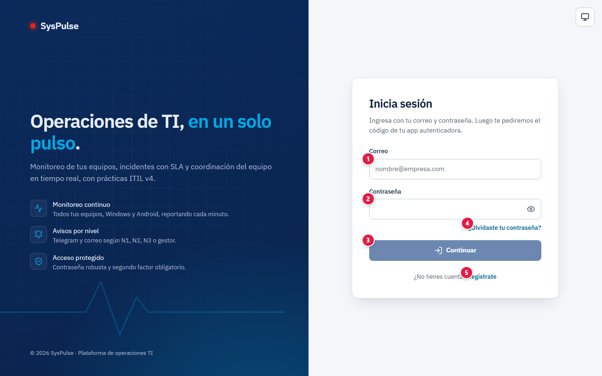

| # | Campo | Qué escribir |
|:-:|---|---|
| 1 | Correo | El correo de tu cuenta |
| 2 | Contraseña | Tu contraseña |
| 3 | Continuar | Valida la contraseña y pide el código de tu verificación en dos pasos |
| 4 | ¿Olvidaste tu contraseña? | Recuperación (ver 3.3) |
| 5 | Regístrate | Crea una cuenta nueva |

**Verificación en dos pasos (obligatoria).** La primera vez eliges cómo recibir el código:

| Método | Cómo funciona |
|---|---|
| **App autenticadora** (recomendado) | Escaneas el QR con Google Authenticator, Microsoft Authenticator u otra app; la app muestra un código nuevo cada 30 segundos, incluso sin internet. Si no puedes escanear, escribe la clave que aparece bajo el QR. |
| **Código por correo** | Cada vez que ingresas te llega un código de 6 dígitos que vence en 10 minutos y sirve una sola vez. Puedes pedir hasta 3 códigos cada 10 minutos (**Enviar un código nuevo**). |

Escribe el primer código, pulsa **Activar** y **guarda los 10 códigos de recuperación**. En los
siguientes ingresos escribe el código y pulsa **Verificar**; si tienes los dos métodos, la pantalla
ofrece usar el otro, y siempre puedes usar un código de recuperación.

### 4.2 Crear una cuenta

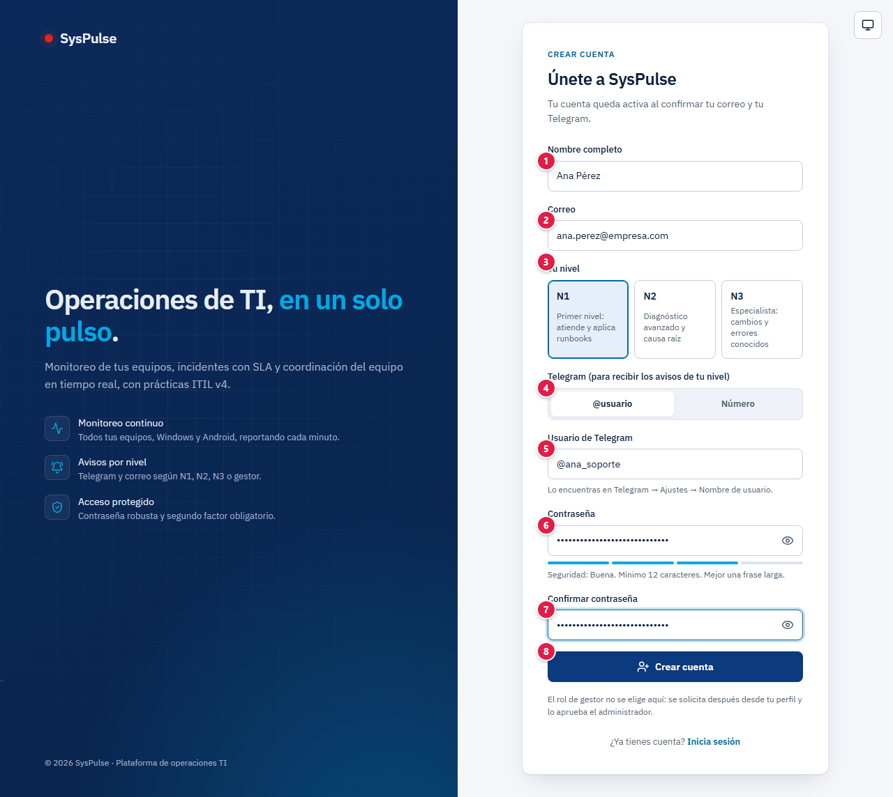

| # | Campo | Qué escribir | Reglas |
|:-:|---|---|---|
| 1 | Nombre completo | Tu nombre | Obligatorio |
| 2 | Correo | Con el que vas a iniciar sesión | Se confirma con un enlace |
| 3 | Tu nivel | **N1** (atiende y aplica runbooks), **N2** (diagnóstico y causa raíz) o **N3** (especialista) | Define qué incidentes te llegan |
| 4 | Telegram | Elige si das tu **@usuario** o tu **número** | — |
| 5 | Usuario de Telegram | Tu @usuario (o país y número, si elegiste Número) | Se confirma con un código del bot |
| 6 | Contraseña | Mejor una frase larga | Mínimo **12 caracteres**; el medidor indica su fuerza |
| 7 | Confirmar contraseña | La misma contraseña | Debe coincidir |
| 8 | Crear cuenta | Botón | Crea la cuenta pendiente de verificación |

Después: confirma tu correo con el enlace, abre el bot de Telegram, pulsa **Iniciar** y escribe el
código que te envía. El rol **gestor** no se elige aquí: se solicita desde tu perfil y lo aprueba el
administrador.

### 4.3 Recuperar la contraseña

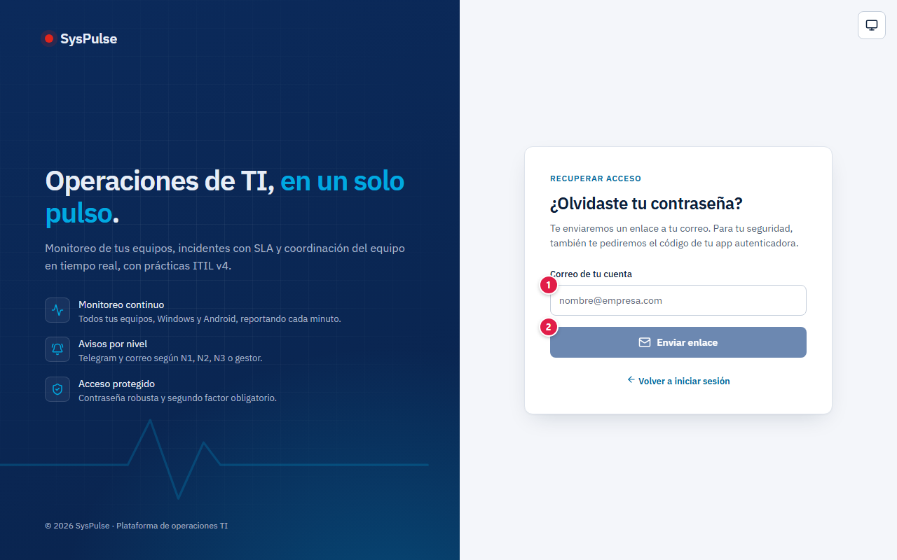

| # | Campo | Qué escribir |
|:-:|---|---|
| 1 | Correo | El correo de tu cuenta |
| 2 | Botón | Envía el enlace de restablecimiento |

Al abrir el enlace, además de la contraseña nueva se pide el **código de tu app autenticadora**:
quien solo tenga acceso a tu correo no puede cambiarla.

### 4.4 Mi turno

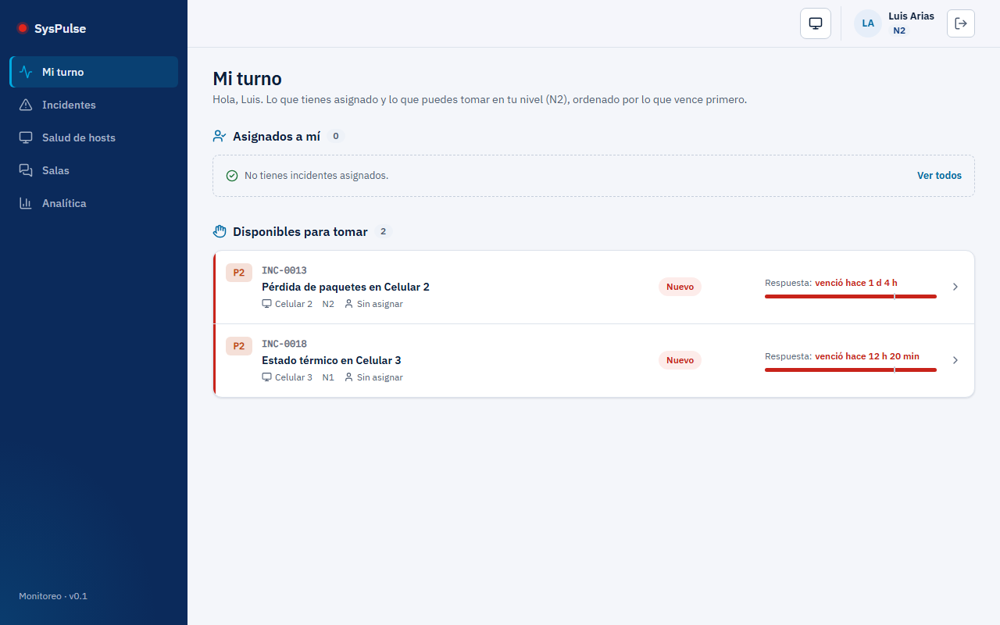

Lo asignado a ti y lo que puedes tomar en tu nivel, ordenado por lo que vence primero. Cada fila
muestra prioridad, código, equipo, nivel, estado y la barra del SLA (en rojo si ya venció). El
gestor ve además los incidentes con SLA en riesgo, vencidos o P1.

### 4.5 Salud de hosts

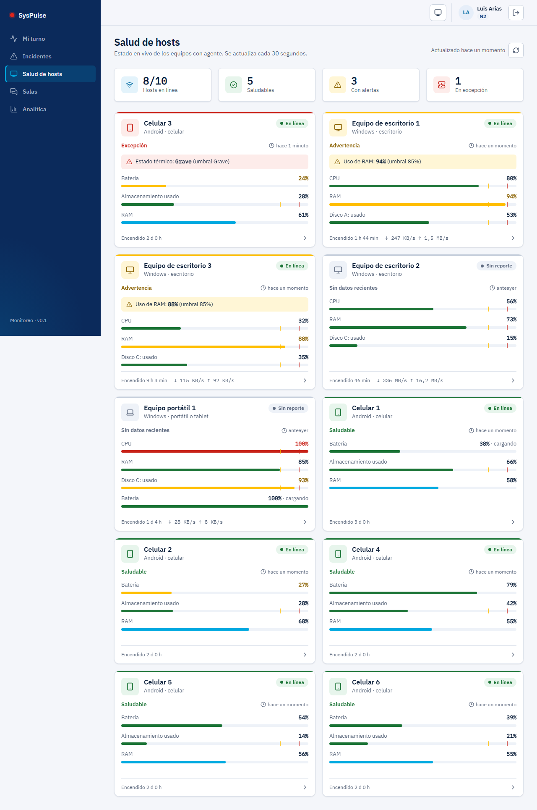

Arriba, cuántos equipos están en línea, saludables, con alertas y en excepción. Debajo, la barra
de herramientas:

- **Buscar por nombre o modelo** (por ejemplo, "Redmi" o "Equipo portátil").
- **Todos / Requieren atención:** el segundo deja solo los equipos con advertencia, excepción, sin
  reporte o retrasados.
- **Tipo de equipo:** escritorios, portátiles o celulares y tablets.
- **Tarjetas / Lista:** la lista muestra una fila por equipo, útil cuando hay muchos. La plataforma
  recuerda tu elección en ese navegador.

Los equipos se agrupan por tipo y, dentro de cada grupo, aparecen primero los que requieren atención.
Cada tarjeta muestra el nombre, el **modelo comercial** (por ejemplo, "Lenovo Tab M11 · Android"), el
estado del agente (**En línea**, **Retrasado**, **Sin reporte**), la salud (**Saludable**,
**Advertencia**, **Excepción**), la alerta activa, sus indicadores con las marcas de umbral y el
**consumo de red** por Wi-Fi, cable UTP y datos móviles, con la conexión activa marcada. Un equipo
sin reporte se ve atenuado: sus valores son viejos. Se actualiza cada 30 segundos.

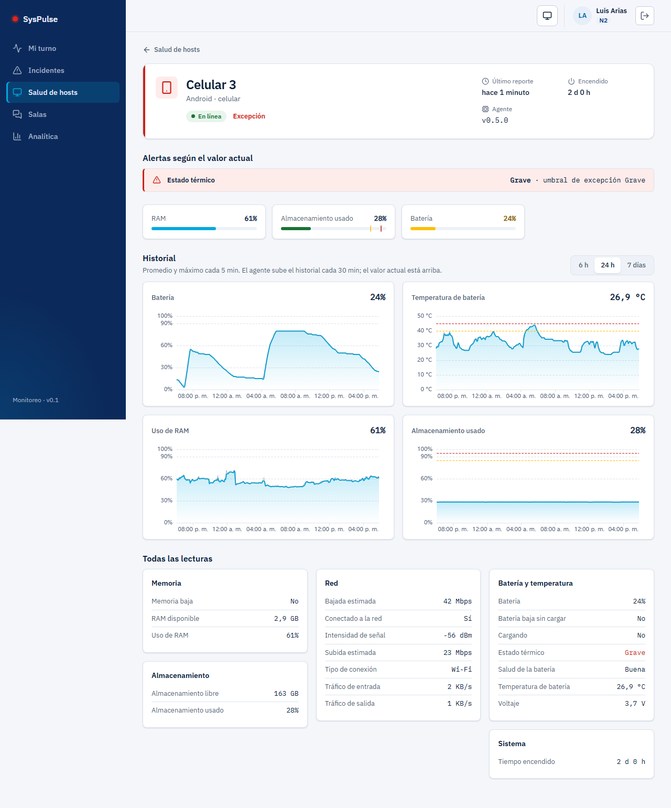

Al abrir un equipo ves sus alertas según el valor actual, las gráficas del historial (6 h, 24 h o
7 días, con las líneas de umbral) y **Todas las lecturas** agrupadas en memoria, almacenamiento,
red, batería y sistema.

### 4.6 Incidentes

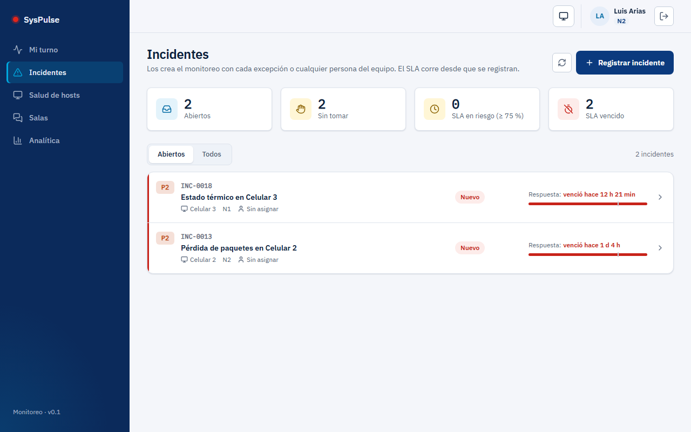

La lista resume los abiertos y los SLA en riesgo o vencidos. **Registrar incidente** abre el
formulario:

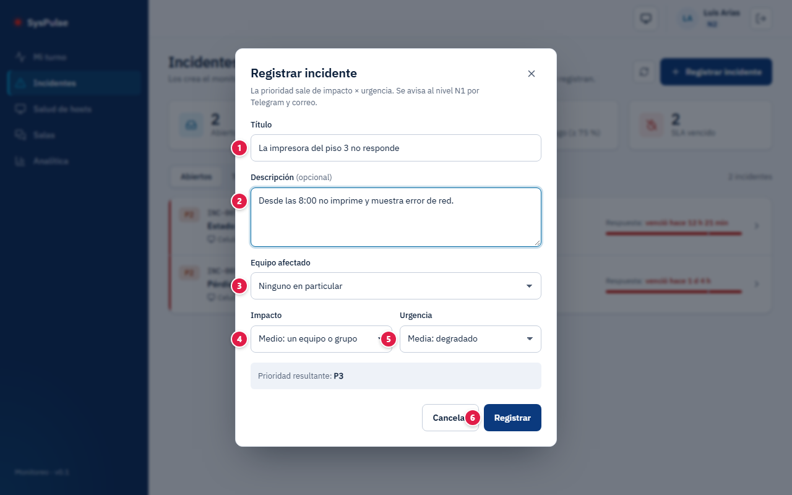

| # | Campo | Qué escribir |
|:-:|---|---|
| 1 | Título | Resumen de la falla (mínimo 5 caracteres, máximo 140) |
| 2 | Descripción | Opcional: qué pasa y desde cuándo (máximo 4.000 caracteres) |
| 3 | Equipo afectado | Uno de los equipos monitoreados, o **Ninguno en particular** |
| 4 | Impacto | **Alto** (muchos afectados), **Medio** (un equipo o grupo) o **Bajo** (una persona) |
| 5 | Urgencia | Qué tan rápido hay que actuar; por ejemplo **Alta** (detenido ahora) o **Media** (degradado) |
| 6 | Registrar | Crea el incidente; la **prioridad resultante** (P1 a P5) se calcula sola con impacto × urgencia y se avisa al nivel N1 |

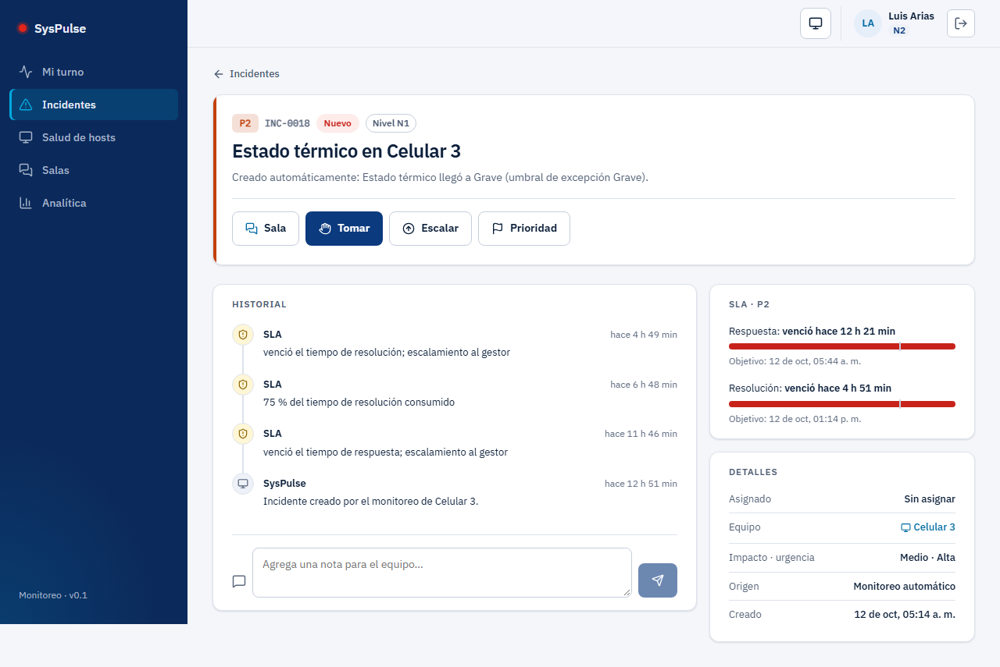

En el detalle, según tu rol, aparecen **Sala**, **Tomar**, **Iniciar trabajo**, **En espera**
(pausa el SLA), **Escalar**, **Asignar**, **Prioridad**, **Resolver** (con código de cierre) y
**Cerrar**. El **Historial** registra cada cambio, incluidos los avisos automáticos del SLA, y el
cuadro de nota agrega comentarios para el equipo. A la derecha, las barras de **Respuesta** y
**Resolución** muestran el plazo consumido.

### 4.7 Salas

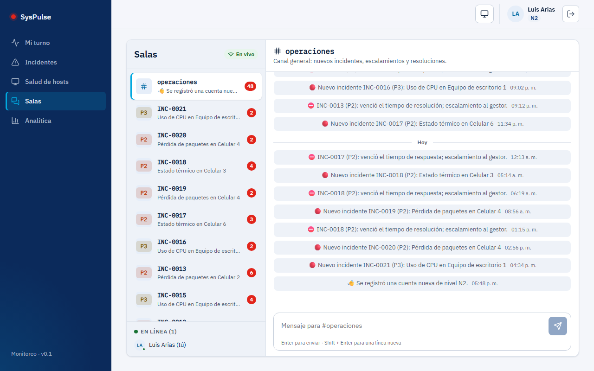

`#operaciones` reúne los avisos generales (incidentes nuevos, escalamientos, resoluciones, cuentas
nuevas) y cada incidente tiene su sala. Escribe en el cuadro inferior (Enter envía, Shift + Enter
hace un salto de línea). Puedes retirar un mensaje propio durante 15 minutos; al cerrarse el
incidente, su sala queda de solo lectura. Abajo a la izquierda ves quién está en línea.

### 4.8 Analítica

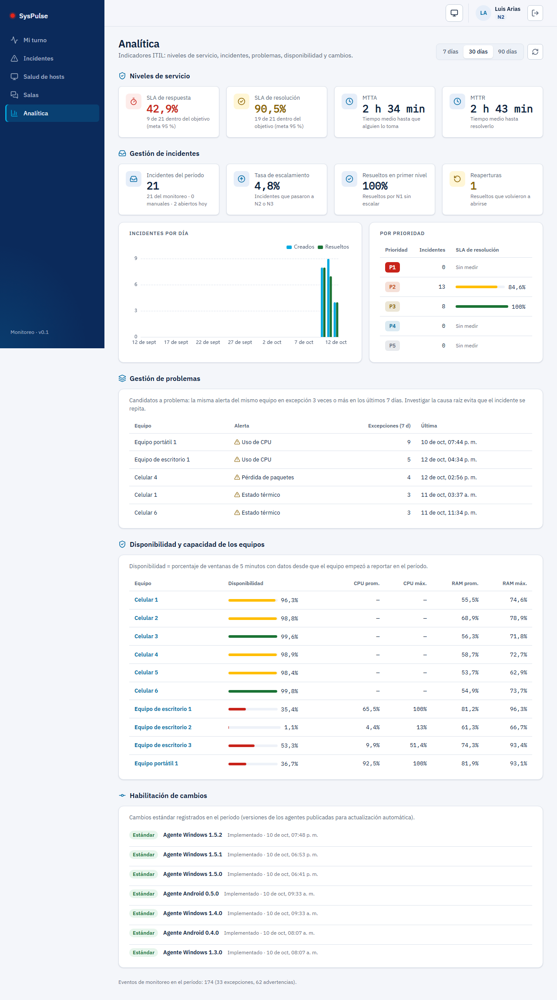

Elige el período (7, 30 o 90 días):

| Bloque | Qué mide |
|---|---|
| Niveles de servicio | Cumplimiento del SLA de respuesta y de resolución, MTTA (tiempo hasta que alguien toma el incidente) y MTTR (tiempo hasta resolverlo) |
| Gestión de incidentes | Incidentes del período, tasa de escalamiento, resueltos en primer nivel y reaperturas; gráfica por día y tabla por prioridad |
| Gestión de problemas | Candidatos a problema: la misma alerta del mismo equipo 3 veces o más en 7 días |
| Disponibilidad y capacidad | Porcentaje de ventanas de 5 minutos con datos y uso promedio y máximo de CPU y RAM por equipo |
| Habilitación de cambios | Versiones de los agentes publicadas, registradas como cambios estándar |

### 4.9 Mi cuenta

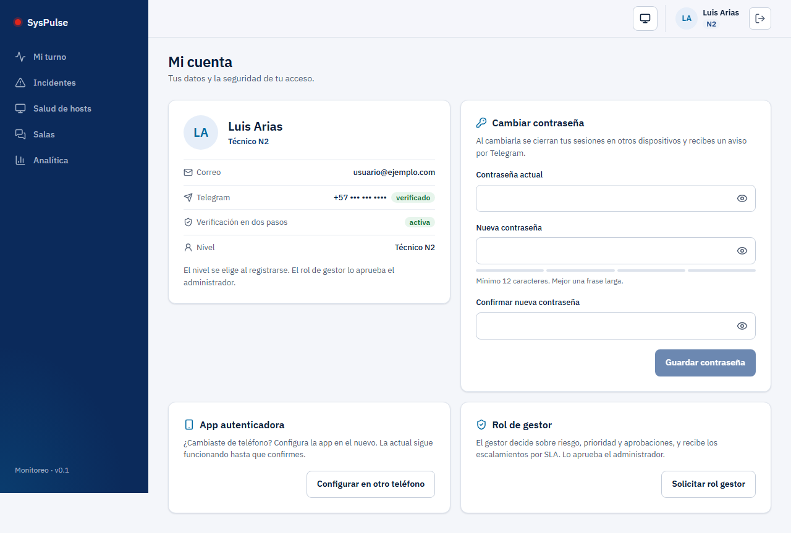

Muestra tu correo, tu Telegram (verificado), el estado de la verificación en dos pasos y tu nivel.
Desde aquí:

- **Cambiar contraseña:** contraseña actual, nueva (mínimo 12 caracteres) y confirmación. Al
  guardarla se cierran tus sesiones en otros dispositivos y recibes un aviso por Telegram.
- **Verificación en dos pasos:** muestra tus métodos activos; **Agregar app autenticadora** o
  **Agregar código por correo** suma el que falta (se confirma con su primer código), y **Pedir la
  app / el correo por defecto** elige cuál se pide al ingresar.
- **App autenticadora → Configurar en otro teléfono:** la app actual sigue funcionando hasta que
  confirmes la nueva.
- **Rol de gestor → Solicitar rol gestor:** la solicitud la aprueba el administrador.

### 4.10 Administración (solo admin)

Agregar, renombrar o retirar equipos; activar o desactivar cuentas; aprobar, rechazar o revocar el
rol gestor; y ajustar umbrales y persistencia de las alertas.

SLA por prioridad:

| Prioridad | Primera respuesta | Resolución |
|---|---|---|
| P1 | 15 min | 4 h |
| P2 | 30 min | 8 h |
| P3 | 2 h | 24 h |
| P4 | 8 h | 72 h |
| P5 | 24 h | 5 días |

### 4.11 Agregar un equipo

1. Si eres **N2 o N3**, pulsa **Agregar equipo** en **Salud de hosts** (también está en
   **Administración → Equipos**) y obtienes un **código de un solo uso** que vence en 24 horas. N1 y
   gestor no ven el botón: pídele el código a un técnico N2 o N3.
2. **Windows:** descarga el agente desde GitHub Releases y, en PowerShell como administrador,
   ejecuta `.\SysPulse.AgentInstaller.exe install --codigo XXXX-XXXX`.
3. **Android:** instala el APK, abre **SysPulse Agent**, escribe el código y pulsa **Vincular**.
4. En menos de un minuto el equipo aparece en **Salud de hosts** con un nombre genérico y su modelo
   comercial.

**Actualizaciones:** son obligatorias.

- **Windows:** forzadas. El servicio "SysPulse Actualizador" revisa cada 15 minutos e instala la
  versión nueva solo; si se detuvo, el agente lo vuelve a iniciar.
- **Android:** aparece una notificación fija **"Actualización obligatoria de SysPulse"** y un aviso
  en la app. Tócala: se abre la descarga oficial y Android te pide confirmar la instalación. La app
  no instala nada por su cuenta, para que Google Play Protect no la marque como riesgosa.

**Google Play Protect:** el agente Android está firmado con la llave propia de SysPulse. Si al
instalarlo Play Protect muestra "app no reconocida", elige **Más detalles → Instalar de todas
formas**: pasa porque la app no se distribuye por Google Play. La app envía los datos por HTTPS, así que perder la señal o pasar de Wi-Fi a datos móviles
no la cierra: lo que no pudo enviar lo guarda y lo reenvía después.

**Si el sistema cierra la app:** algunos teléfonos (por ejemplo Xiaomi y Redmi con su ahorro de
batería) cierran apps en segundo plano. SysPulse revisa cada 15 minutos que el monitoreo siga
activo y, si se cerró o dejó de medir, lo vuelve a abrir solo. En la pantalla de la app, un aviso
como "sin conexión momentánea; se reintenta solo" es normal al cambiar de red: los datos quedan
guardados y se envían cuando vuelve la conexión, y el aviso desaparece solo. Para que funcione
mejor, en Ajustes → Batería deja SysPulse **sin restricciones**.

En Windows, el servicio "SysPulse Actualizador" se reinicia solo después de actualizarse.

### 4.12 Preguntas frecuentes

**¿El agente puede ver mis archivos o lo que escribo?** No. Solo envía las métricas técnicas de la
tabla de la sección 4.

**¿Qué es la animación al abrir la app?** Si instalaste SysPulse como app, al abrirla desde su
ícono se dibuja el pulso durante un segundo y medio. En el navegador no aparece. El ícono del
escritorio del teléfono no se anima: Android no lo permite a ninguna app.

**¿Por qué mi alerta no abrió un incidente?** El valor debe superar el umbral durante 8 minutos
seguidos; los picos breves se ignoran a propósito.

**¿Cómo llego a ser gestor?** Desde tu nombre, arriba a la derecha → solicitar el rol de gestor.
El admin lo aprueba o rechaza.

**¿Qué significa la pantalla "Estamos en mantenimiento"?** El servicio o su base de datos no están respondiendo en ese momento. No se perdió nada: tus equipos, incidentes y mensajes siguen guardados, y ninguna acción quedó a medias (si no viste la confirmación, no se guardó). La pantalla se actualiza sola y vuelve a la normalidad apenas el servicio responda; también puedes reintentar más tarde.

## 5. Seguridad: tu información protegida

Tu confianza es lo primero: la plataforma solo pide los datos necesarios para funcionar, los protege y no los comparte con terceros. Esto es lo que se guarda y cómo se protege.

### Qué datos se guardan y dónde

**Personas**

| Dato | Para qué se usa | Dónde se guarda | Cómo se protege |
|---|---|---|---|
| Nombre, correo y nivel | Identificarte y asignarte incidentes | MongoDB Atlas | Solo los ve el equipo de operaciones |
| Usuario o número de Telegram | Enviarte los avisos de tu nivel | MongoDB Atlas | Se verifica con un código del bot |
| Contraseña | Iniciar sesión | MongoDB Atlas, **solo su huella PBKDF2** | No se puede leer ni recuperar |
| Secreto de la app autenticadora | Segundo factor | MongoDB Atlas, **cifrado con AES-GCM** | La clave de cifrado vive fuera de la base |
| Código por correo | Segundo factor | MongoDB Atlas, **solo su huella** (10 minutos) | Nadie: no se puede leer |
| Códigos de recuperación y enlaces | Recuperar el acceso | Solo su huella SHA-256 | Un solo uso, con límite de intentos |
| Sesión | Mantenerte conectado | `sessionStorage` del navegador | Se borra al cerrar la pestaña; dura 8 horas |

**Equipos monitoreados:** solo métricas técnicas de salud.

| Se captura | No se captura nunca |
|---|---|
| Identificador anónimo (`win-` / `and-` + huella de 10 caracteres) | Nombre del equipo, usuario de Windows o cuenta del celular |
| Tipo de equipo, versión del agente y modelo comercial (p. ej. "Lenovo Tab M11") | Nombre que el dueño le puso al equipo, número de serie o IMEI |
| CPU, memoria, paginación y disco (promedio, mínimo, máximo y percentil 95) | Archivos, documentos, fotos, contactos o mensajes |
| Tráfico y consumo por Wi-Fi, cable UTP y datos móviles; errores, latencia y pérdida hacia DNS públicos, señal y número de puertos en escucha | Direcciones IP, ubicación, nombre de la red Wi-Fi o aplicaciones instaladas |
| Almacenamiento libre y, en celulares, batería y temperatura | Historial de navegación o pulsaciones de teclado |

Las métricas se conservan 90 días.

### Cómo se protege tu información

Comprobado en el código del proyecto (`src/SysPulse.Infrastructure/Cuentas`,
`src/SysPulse.Infrastructure/Seguridad`, `src/SysPulse.Api`, `web/src/sesion.tsx`):

- **Contraseñas con PBKDF2** (`PasswordHasher` de ASP.NET Core) y mínimo de 12 caracteres.
- **MFA obligatorio** con app autenticadora (TOTP) o código por correo, y 10 códigos de
  recuperación; el secreto del autenticador se guarda cifrado con AES-GCM y el código del correo
  solo como huella (vence en 10 minutos y sirve una vez). Un código de la app no se acepta dos veces
  y 5 códigos errados bloquean el segundo factor 15 minutos.
- **Bloqueo por intentos:** 5 contraseñas erradas bloquean la cuenta 15 minutos; los códigos de
  verificación admiten 5 intentos y se comparan en tiempo constante.
- **Límite de peticiones** en los endpoints de autenticación (20 por minuto) y de los agentes (60
  por minuto).
- **Cuentas verificadas:** correo y Telegram se confirman antes de activar la cuenta.
- **Sesiones revocables:** el JWT dura 8 horas y deja de servir si cambian la contraseña, el MFA o
  el rol. En el navegador vive en `sessionStorage`, que se borra al cerrar la pestaña.
- **Roles en el servidor:** N1, N2 y N3 se eligen al registrarse; el rol gestor solo lo aprueba el
  admin; todas las rutas de administración exigen rol admin; generar códigos de alta exige N2, N3 o
  admin. Nadie borra datos: solo se desactiva
  o retira, y la auditoría es de solo inserción.
- **Privacidad de los equipos:** nombres genéricos y solo métricas técnicas (ver la tabla
  anterior).
- **Agentes sin secretos:** el equipo recibe su configuración al canjear un código de un solo uso
  (solo se guarda su huella) y la guarda cifrada (DPAPI en Windows, Android Keystore). Recibe solo
  una credencial de base exclusiva de los agentes, limitada a sus colecciones de métricas, y la
  clave que solo permite registrar eventos: nunca la cadena de la API ni el token de Telegram. Los
  avisos los envía solo el servidor. Antes de
  publicar, `tools/escanear-secretos.ps1` revisa que los paquetes no lleven secretos.
- **Actualizaciones verificadas:** los agentes solo se actualizan desde GitHub Releases por HTTPS y
  descartan cualquier archivo cuya huella SHA-256 no coincida.
- **CORS restringido** a la web oficial y secretos solo en variables de entorno de Render.
- **Al día en seguridad:** el runtime, el sistema y las dependencias se mantienen con los últimos
  parches y se revisan periódicamente.

## 6. Agradecimientos

A mi familia, por su apoyo incondicional, su paciencia y por creer en cada proyecto incluso cuando apenas era una idea. Este trabajo también es de ustedes.

Y a ti, que usas esta plataforma: cada prueba, comentario y sugerencia ayuda a que siga mejorando.
